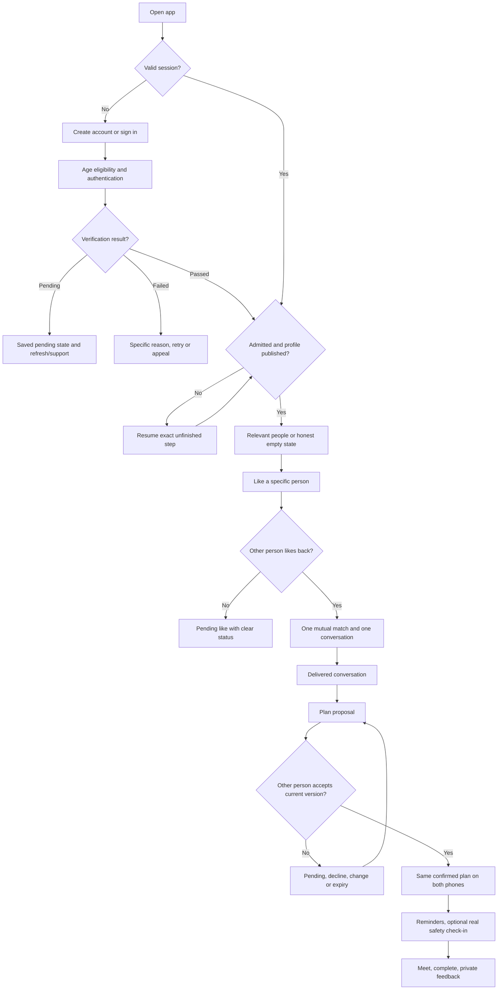

# Customer workflow review: Carino

Review date: November 15, 2026. Audience: product owner, designer, developers and QA.

**Baseline report:** see the [deeper control-by-control audit](audit/DEEP-WORKFLOW-AUDIT.md) for the expanded source census, forward/back/cancel coverage ledger, additional gaps and reconciliation of fixes made after this baseline. Findings below must not be treated as an immutable description of later edits.

**The app has many navigable screens, but the core customer journey is not yet complete across real accounts. The biggest improvement is to finish the consequences of existing actions: save my profile, deliver my like, create a mutual match, send my message, agree a plan, and reliably enforce my safety choices.**

This report reviews the current working tree, including pre-existing uncommitted work. No application code was changed for this audit. Some files changed during review; notification routing was re-read, and an earlier dead-tap finding was withdrawn because a fallback destination was added. Findings below describe the later inspected version.

## How to use this report

- Start with the P0 findings, then the first complete customer journey in the build sequence.
- Use [CUSTOMER-ACTION-MAP.csv](CUSTOMER-ACTION-MAP.csv) as the click/destination inventory.
- Use [CUSTOMER-WORKFLOW-QA.csv](CUSTOMER-WORKFLOW-QA.csv) as the scenario checklist. These are proposed acceptance tests, not a claim that the scenarios have passed.
- A screen opening is only one part of completion. A completed action needs a truthful result, saved state, the correct recipient's result, recovery on failure, and consistent behavior after reopening.

Evidence levels: **Confirmed** means the source explicitly implements the described behavior or omission; **Integration gap** means the customer outcome has a placeholder/local implementation and needs a real service; **Design gap** means a recommended interaction or product decision; **Device validation** means behavior still requires testing on hardware. Source confirmation is not the same as reproducing the issue on a device.

Priorities: **P0** = trust, safety, or a fundamental launch blocker; **P1** = blocks or breaks a main journey; **P2** = significant friction or secondary functionality; **P3** = later enhancement. These are product priorities, not measured incident severities.

## Verification and limits

Reviewed onboarding/root routing, discovery and full profiles, likes, chat and settings, media, groups, Stage, Moments, Spark calls, plan composition/details/list, events/hosting, privacy/safety/support, subscriptions, couples/referrals, shared state and service boundaries. Inspected existing mobile-sized screenshots for Dates, Plans and You; these captures predate some current changes and were used only for structural observations confirmed against source. No claim of a fresh visual, contrast, or screen-reader audit is made.

Existing automated suite: **149 tests passed; 68 screenshot scenarios skipped**, from `flutter_tools.snapshot test --no-pub --reporter expanded`. Log: `build/customer-audit-tests.log`. The initial sandboxed attempt could not access Flutter's SDK lockfile; the permitted retry produced the passing result. Tests exercise mostly local/demo behavior; they do not establish two-person delivery, live vendor verification, store billing, push delivery, or process-restart continuity. No live credentials, paid transactions, external messages, or moderation operations were used.

This is a broad source-based workflow audit, not proof of every theoretically possible interaction. The checklist deliberately makes remaining live/device verification visible. Existing README/handoff claims were treated as context, not evidence that an outcome works.

## The customer journey that must work first

Current implementation breaks this chain at profile saving, live discovery/likes/chat, plan creation and bilateral agreement. Additional features should not obscure these breaks.

## Priority findings and exact improvements

### F01 — P0: date check-in promises protection it does not perform

**Customer scenario:** Plans → confirmed plan → add trusted contact → Start check-in → close app → miss check-in.

**Current:** `_checkInActive` is a screen boolean. No scheduled job, contact delivery, acknowledgement, retry or escalation is started. The screen says it will ask at the chosen time and notify the contact after 15 minutes. The help sheet also describes flagging the plan, with a demo caveat. The primary active-check-in promise has no corresponding delivery mechanism.

**Build:** keep this unavailable or explicitly labelled a non-protective preview until there is durable scheduling, timezone-aware deadlines, contact consent/validation, actual delivery, delivery failure handling, cancel/end acknowledgement and reliable reopen state. Do not show “Active” before the server accepts the schedule. Give customers a clear fallback when unavailable.

**Done when:** close/kill both apps; miss the deadline; the intended contact receives exactly one authorised alert, or the member sees a delivery failure. Ending the check-in cancels the alert across devices.

Evidence: `lib/screens/connect/plan_detail_screen.dart:42`, `_checkInCard`, `_addContact`.

### F02 — P0: the live switch does not turn the main experience into a real app

**Current:** Dates starts from `MockData.members`; its like/pass handlers do not call `BackendService.recordLike/recordPass`. Conversations append to the in-memory sample list. Plans and matches use sample getters. Worldwide calls `fetchFeed()` but discards its rows and returns sample members. Supplying server settings alone therefore leaves sample people and local-only interactions in key screens.

**Build:** route each feature through real repositories, map responses to displayed models, and enforce a clear demo/live boundary. Never substitute sample people after a successful live request or when the real result is empty. Keep demo previews visually labelled throughout.

**Done when:** a fresh live account sees only actual eligible accounts; A's action is visible to B; restarting A preserves it; an empty live city stays honestly empty.

Evidence: `discover_screen.dart:47`, `_commit`; `worldwide_screen.dart:29`; `conversation_screen.dart:371`; `backend_service.dart:64`.

### F03 — P0: blocking is not a consistent end-to-end customer control

**Current:** the backend has a block insertion path, but demo mode returns without recording a block. A conversation can set a local `_blocked` flag; other entry points simply pop routes. The Privacy Centre's blocked list is independently seeded with `m-marcus`; Unblock only removes that local row. Sample decks/chats are not globally filtered by a shared block state.

**Build:** one account-scoped block state used everywhere, with server acknowledgement and immediate local removal. Wire unblock to the same relationship. Preserve a safe report/evidence path. Specify effects on existing shared groups and plans.

**Done when:** block through profile/chat/call → person disappears from all relevant surfaces on both devices; cannot message/call; blocked list is accurate after restart; unblock does not silently recreate a match.

Evidence: `widgets/safety_actions.dart:298`; `backend_service.dart:139`; `privacy_centre_screen.dart:21`; conversation `_blocked`.

### F04 — P0: sensitive and account-specific state is not isolated by account

**Current:** `Services` holds global auth-independent prefs, social/trust objects and payments. SharedPreferences uses keys such as `sync`, `hiddenChats` and `mockVerified` without a user namespace. Sign-out does not clear/reload that account's data. In demo, another arbitrary contact signs into the same state; in live mode locally stored profile/notes can still survive account changes.

**Build:** scope member data by authenticated account, clear in-memory caches and entitlement state on account change, reload from the right account, and define what deliberately survives as device preferences. Delete local account data after confirmed deletion. Keep device-wide age/lock policy separate from profile data.

**Done when:** A logs out; B logs in on the same phone; B never sees A's notes, profile choices, likes or partner information. Deletion does not restore that data on the next account.

Evidence: `services/services.dart:29`, `UserPrefs.load/save`, `_syncJson`; `auth_service.dart:169`.

### F05 — P1: the main Publish button discards profile answers

**Reproduce:** add three photos, type a unique bio, prompts and boundaries, choose languages/interests, then use the main **Publish profile** button without entering Preview.

**Current:** that button calls `widget.onPublished` directly. Only **Looks right — publish** inside Preview copies those fields to prefs and calls `save()`. Two buttons promising the same operation have different consequences.

**Build:** one shared publish operation, used from both buttons, with validation, saving/error handling and completion only after success. Do not require Preview as an undocumented saving step.

**Done when:** either publish path produces identical saved data in You, public profile, edit mode and after restart.

Evidence: `onboarding/profile_creation_screen.dart:505` versus `:582`.

### F06 — P1: photo/video/voice profile work is not retained

**Current:** adding a photo cycles through three bundled images; photo slots start empty on each editor opening. Video and voice actions toggle booleans. Neither publish path saves the actual media selections/captions. Lifestyle is selected but never saved; there is no real capture/upload/moderation pipeline.

**Build:** real picker/recorder, editable persisted media, upload progress/cancel/retry, moderation result and main-photo verification. Preserve media when editing text. Validate the profile requirements consistently; current publish validation only requires three photos and captions when the video toggle is on, despite comments describing three prompts.

**Done when:** the customer's own media appears in editor, preview and public profile after restart; failed/rejected uploads cannot masquerade as published media.

Evidence: `profile_creation_screen.dart:32`, `:37`, `_photoTap`, `_canPublish`, preview publish; `services.dart` getter `me`.

### F07 — P1: name, age and preview do not reflect the actual customer

**Current:** `prefs.me` inherits name, age, city and photo from `MockData.currentUser`. Preview hard-codes “You, 26 · ~this city”; the demo current user has a different age. DOB entry is not connected to that displayed identity. Preview is a separate rendering, not the same public profile component.

**Build:** a real verified-identity/profile model, a correction/help route for mistakes and one preview using the same field/audience rules as the actual public view. Avoid publishing optional personal fields without a clear choice.

**Done when:** age/first name agree across onboarding, preview, You, chat and another account's view; hidden fields stay hidden in each audience preview.

Evidence: `services.dart` getter `me`; `profile_creation_screen.dart:545`.

### F08 — P1: password login asks for a credential signup never creates

**Customer:** “I joined with a code yesterday. Today the app asks me for a username and password. What password?”

**Current:** the returning screen leads with Username/Password; onboarding only creates an OTP/demo session. No password creation/reset route was found. “Forgot password?” opens OTP, which can recover access but does not set a new password. “Username” actually means email/phone.

**Build:** lead with the sign-in method the product actually supports, rename the contact field, and either implement optional password setup/change/recovery or remove the unused promise. Do not imply a password exists.

**Done when:** a new OTP user can return without guessing credentials; password users can actually reset and reuse a new password if passwords are retained.

Evidence: `onboarding/sign_in_screen.dart:145`, `:180`; `auth_screen.dart`; `auth_service.dart:103`.

### F09 — P1: passkey routes are inconsistent and unfinished

**Current:** returning sign-in attempts biometric unlock then explicitly refuses live passkeys when no session exists. Signup's Continue with passkey calls `signInDemo()` and invokes authentication completion without checking its result. In live mode this can advance to verification with no newly authenticated session. Settings passkey setup only displays an integration message.

**Build:** implement a real server-backed credential ceremony, or disable all unsupported entry points with an honest alternative. A local fingerprint unlock alone is not account sign-in.

**Done when:** success, cancel, no credential, unsupported device, lost device and server failure all leave the customer in an accurate state; verification never opens on false authentication success.

Evidence: `auth_screen.dart:127`; `sign_in_screen.dart:91`; `settings_screen.dart:99`; `auth_service.dart:38`.

### F10 — P1: returning sessions cannot reliably resume the correct stage

**Current:** root starts on Welcome. `_afterSignIn` checks verification and sends any verified account straight Home, marking onboarding complete. It does not check a published profile, city admission or the exact unfinished onboarding step. A member who verifies then quits before publishing can return past the unfinished work.

**Build:** server-backed routing state for eligibility, authentication, verification, admission, profile publication and restrictions. Check restored sessions automatically. Distinguish “not verified” from “could not check because offline.” Preserve an intended notification/invite destination through sign-in.

**Done when:** kill/reopen at every onboarding step; the correct draft/stage resumes. A verified but unpublished/waitlisted account cannot bypass its unfinished gate by signing in again.

Evidence: `root_flow.dart:46`, `:75`; `verification_service.dart:isVerified`.

### F11 — P1: OTP recovery and request failure need a complete state model

**Current:** resend cooldown and alternate-contact routes exist. Attempts/lockout display is local; the locked screen says “later” without an unlock time or working passkey button in that branch. Phone entry lacks country selection/normalisation. The service handles `AuthException`, leaving other network errors without a demonstrated UI recovery. Wrong-code attempts should not be consumed for connectivity failures.

**Build:** explicit invalid/expired code, throttled-until, network failure, contact correction and recovery states, with provider truth driving limits. Add OTP autofill/paste support and international number validation.

**Done when:** typo, delayed code, old code after resend, offline verification, retry, lockout expiry and lost-contact recovery are understandable without abandoning the app.

Evidence: `auth_screen.dart:_contactValid`, `_verify`, locked branch; `auth_service.dart:sendOtp/verifyOtp`.

### F12 — P1: live verification can stall indefinitely

**Current:** the provider UI simulates capture with timed phases. Live `runDemoFlow()` starts a session and remains pending. The included edge function creates pending records and references; it does not create a vendor inquiry/token or process a result webhook. The pending screen does not poll or subscribe to a decision. “OK — notify me” pops navigator routes but onboarding is an enum within the root route, so it is not a meaningful exit/resume operation.

**Build:** vendor flow + webhook + durable status subscription/refresh, pending exit/resume and actionable failure categories. Handle SDK cancellation, provider outage, duplicate submission and alternative verification/help.

**Done when:** a real result can move a pending customer forward without restarting verification, and a failure gives the actual reason and a usable next step.

Evidence: `verification_flow_screen.dart:_advance`, `_pending`; `verification_service.dart:runDemoFlow`; `backend/supabase/functions/verification-session/index.ts`.

### F13 — P1: Daily Drop does not consume its cards

**Reproduce:** Dates → Daily Drop → Like or Pass the first card.

**Current:** `_visibleDeck` reads a fresh `MockData.dailyDrop` list; `_commit` removes from `_deck` only. The same first Daily Drop profile can remain at the front and the displayed count does not fall. The Drop branch also ignores the age/language/distance/intention filters used by Nearby.

**Build:** one per-day candidate/decision state, consistent dealbreaker rules, decremented remaining count and a genuine exhausted state. Decide whether preference filters differ from dealbreakers and explain that clearly.

**Done when:** every member can be acted on once per intended policy, the next card appears, and restart/tab switching does not reset the day.

Evidence: `discover_screen.dart:52`, `:131`, Daily Drop chip.

### F14 — P1: Like/Pass works differently depending on where a profile was opened

**Current:** full profile buttons pop a boolean. Dates awaits that result and commits the action. Worldwide, Plus Likes You and wingperson suggestions push the same profile without handling its result. Their Like/Pass closes the page without recording the decision.

**Build:** put the person-specific action in a shared operation; every entry point invokes it or handles its typed result. Avoid actions which operate on whichever card is currently first instead of the intended member ID.

**Done when:** like the same eligible person via Dates, full profile, Worldwide, Likes You and wingperson; all paths yield one consistent pending-like/match outcome.

Evidence: `profile_detail_screen.dart` Pass/Like buttons; `discover_screen.dart` `onOpen`; `worldwide_screen.dart` profile push; `connect_screen.dart:399`; `wingperson_screen.dart`.

### F15 — P1: notes, prompt hearts and Spark promises lose their meaning

**Current:** note text reaches `_commit` but is only used to choose an analytics event; it is not stored or delivered. Prompt hearts call a generic like without a prompt ID. Spark spends the allowance before the actual commit; it does not deliver a recorded priority like/note. Choosing Spark also discards the text typed in the like-options note field. Gifts announce demo sending without a delivery object.

**Build:** a structured like containing recipient, kind, note, anchor and delivery status. Spend limited allowance only on successful authoritative acceptance; restore on failure. Let the customer preview their chosen note/gift/Spark.

**Done when:** B sees precisely the note/prompt/media A sent; Spark count changes once; retries cannot spend twice; cancelling spends nothing.

Evidence: `experience_screens.dart:149`, Spark `LikeChoice`; `discover_screen.dart:_likeOptions/_commit`.

### F16 — P1: match, outbound likes and undo are not one lifecycle

**Current:** mutuality uses sample `likesYou`; matching creates an in-memory chat but the matches getter remains sample-based. “You liked” shows matched text without a direct chat action. Undo like removes an ID without saving, retracting a server like or defining consequences for an existing match. Pass is not persisted, so dismissed people can return after relaunch. Snackbar Undo uses one mutable `_lastPassed`, so an earlier visible Undo can act on a later pass.

**Build:** a single like/match state machine; explicit pending, matched, withdrawn, passed, unmatched, blocked/deleted outcomes. Capture the exact passed member in the undo action. Offer Message for matched outbound likes and a separate unmatch action with clear consequences.

**Done when:** all lists agree immediately and after restart; old Undo acts only on its own person; withdrawing an existing match follows a documented policy.

Evidence: `discover_screen.dart:_commit/_showMatch`; `likes_manager_screen.dart:79`; `mock_data.dart:matches/chatWith`.

### F17 — P1: message sending lacks delivery, failure and durable continuity

**Current:** sending inserts a `ChatMessage` into a shared in-memory list. It survives reopening that screen in the same process, which is covered by an existing test; it is not saved across process death or sent to another account. There is no authoritative sending/sent/delivered/failed state or retry path.

**Build:** durable conversation/message storage, realtime delivery, stable IDs and idempotent retries, offline handling, failed-send recovery and scroll-to-new-message behavior. Preserve unsent drafts when navigating away.

**Done when:** A sends while B is online/offline; messages arrive once, order correctly and survive restarts; a failed send remains editable/retryable.

Evidence: `conversation_screen.dart:371`; `mock_data.dart:conversations/chatWith`; `models/message.dart`.

### F18 — P0: Vanish copy promises expiry that direct chats do not implement

**Current:** direct-chat mode changes immediately locally. New direct-chat messages have no expiry/read timestamps and no expiry engine; `dissolved` is a display flag. A mode label is not deletion. Group demo chat separately uses a local 24-hour expiry, illustrating inconsistent policies. Existing Keep history must not be reinterpreted by a conversation-wide toggle.

**Build:** bilateral consent, per-message mode/version/read/expiry state, server deletion and cache/media handling. Define readable retention/evidence rules. Keep claims unavailable until exercised across devices and background/reopen.

**Done when:** new Vanish messages expire at the agreed time on both phones, old Keep messages remain, consent rejection leaves mode unchanged, and expired messages are absent from search/media caches.

Evidence: `conversation_screen.dart:_send/_proposeModeSwitch`; `conversation_settings_screen.dart:88`; `models/message.dart`; `social_screens.dart:294`.

### F19 — P1: view-once media is consumed before the first view

**Reproduce:** open a view-once photo bubble.

**Current:** chat sets `mediaConsumed = true` before pushing `MediaViewerScreen`; that viewer reads the same object and renders the “already opened” placeholder. The first viewing can be lost without showing the photo.

**Build:** an authorised first-view session that displays the content, then records consumption according to a clearly stated rule. Define failure behavior for decode/download error, interruption and offline opening. Subsequent opens must be denied.

**Done when:** first open shows the image; close/reopen shows a tombstone; two devices cannot consume it twice; failed loading follows the disclosed policy.

Evidence: `conversation_screen.dart:953`; `media_viewer_screen.dart:19`.

### F20 — P1: photo/voice send and media reporting are placeholders

**Current:** photo send inserts a bundled backdrop; voice note adds a text label. Media Report tells users to find the chat menu instead of filing a report for the selected object. Screen-capture promises also need platform evidence: Android has a secure-window bridge, but an iOS screenshot-event notification path was not found in the inspected native source.

**Build:** capture/select/preview/upload/playback, recording duration and cancellation, media-level report context, unavailable/failed/loading states, and platform-accurate capture copy. Test actual hardware; do not imply guaranteed capture notification.

**Done when:** selected media reaches the recipient and can be reported directly; interrupted uploads recover; camera/mic denial provides a usable alternative.

Evidence: `conversation_screen.dart:_sendMedia/_sendVoiceNote`; `media_viewer_screen.dart:29`; `widgets/secure_screen.dart`; Android `MainActivity.kt`.

### F21 — P1: closing kindly says a message was sent but sends nothing

**Current:** Likes manager removes a local intro and displays a “placed in chat” message. Chat List's Close the Loop hides a conversation in a local set and says “Sent”; it does not append/send the selected message or expose a durable archive/reopen path.

**Build:** an explicit review/send action and a real archived state. Only show sent after acceptance. Decide whether a closing message allows replies and whether archive is reversible; reserve Block for stopping contact.

**Done when:** the other person receives exactly the approved words; archive survives restart; the sender can find it later; failed send does not hide the conversation as if completed.

Evidence: `likes_manager_screen.dart:31`; `chat_list_screen.dart:51`.

### F22 — P1: sending a plan does not create a stored plan or send the note

**Current:** Send plan suggestion opens detail with place type/time. It does not create a plan record, send a chat invitation or pass `_note.text` to the detail. The suggestion cannot appear in Your plans through this operation.

**Build:** a durable proposal with sender/recipient, note, date/time/timezone, place, version and ID. Display “Waiting for [person]” with the proposal in chat and Plans.

**Done when:** B receives the exact suggestion and note; A can reopen it from Plans/chat after restart; a failed send leaves an editable draft.

Evidence: `plan_composer_screen.dart:163`; `plans_list_screen.dart:16`.

### F23 — P1: one person can label their own plan “Both confirmed”

**Current:** Confirm plan sets `_confirmed = true` locally even while the page says it is waiting for the other person. There is no actor/role distinction or versioned second-person acceptance.

**Build:** distinguish proposer and recipient; accept/decline/change permissions depend on actor and current version. Both agree to the same proposal. Treat stale accept, simultaneous cancel/change and repeated taps explicitly.

**Done when:** the proposer cannot accept on the recipient's behalf; both devices render the same final version/state; conflicting changes cannot produce false confirmation.

Evidence: `plan_detail_screen.dart:104` and status chip.

### F24 — P1: plan change, decline and cancellation do not complete their consequences

**Current:** rescheduling opens a fresh composer without a plan ID. Decline's send-template action does not mark decline because it uses `confirmCancel = false`; cancellation only updates the current widget. Neither sends the message it claims to send. “Write my own instead” closes the sheet rather than opening a pre-addressed composer. Calendar export only shows a snackbar; arrival/home-safe flags are local.

**Build:** versioned plan mutations and real notifications/messages, effective cancellation across list/chat/calendar/check-ins, a prefilled chat composer and actual calendar export. Add absolute dates/timezones, conflict warnings and invalid/past-time handling.

**Done when:** change/decline/cancel is reflected everywhere; no obsolete reminder/check-in runs; calendar export uses the agreed version; the custom message path is usable.

Evidence: `plan_detail_screen.dart:_politeSheet`, Reschedule, Add to calendar; `plan_composer_screen.dart:_timeOptions`.

### F25 — P1: hosting, Post → Plan and booking produce invisible records

**Current:** Post the plan, Host a plan and Decompress append text to `prefs.myPlans`/`bookings`. Your plans reads `MockData.plans`; Tonight reads its own sample list. There is no reader joining these new entries to the promised destination, participant invitations or RSVP receipts. Booking confirmation is local and can say “You're booked” without a venue reservation.

**Build:** a shared structured plan/booking store, correct destination after creation, real invite/RSVP/capacity states, actual provider handoff and confirmed booking reference. Distinguish an idea, an enquiry and a paid/confirmed reservation.

**Done when:** the new item appears immediately and after restart where promised; invitees can act; a reservation is never called booked without provider confirmation.

Evidence: `widgets/post_to_plan_sheet.dart:71`; `plans_hub_screens.dart:_publish`; `decompress_screens.dart:382`; `plans_list_screen.dart:16`.

### F26 — P1: Spark call actions do not form an actual connection

**Current:** call screen always joins `joinDemoSession`; tracks/signalling are not integrated. After a call, Connect — open chat and Pass both pop the same two routes. Neither records a decision or opens/creates a mutual chat. Pre-call uses a fixed sample inviter; declining the preview ring promises a missed-call note without creating one.

**Build:** actual mutual invitations, accepted room tokens/media, no-answer/busy/expired/declined states, permission handling, disconnect/reconnect and durable post-call choices. Open a chat only after both real choices agree.

**Done when:** two devices can accept, see/hear, leave immediately, and make private independent choices; only mutual Connect creates one conversation.

Evidence: `spark_session_screen.dart:359`, `_endCall`; `video_service.dart`; `connect_screen.dart` incoming-call preview.

### F27 — P0: reports and human support include false-success paths

**Current:** structured report/appeal screens do call backend methods, but lack demonstrated request-error recovery; report submit can remain “Sending” on an exception. Stage Report is only a snackbar saying a human will review. Talk to a human only announces a handoff, without creating a ticket. Cases in safety/support are static/sample rather than the submitted record. Report copy promises automatic sealed evidence while the request submits text/user/surface, without an explicit evidence object.

**Build:** one report/ticket flow for all surfaces, retry and duplicate protection, correct content IDs/evidence linkage, durable case receipt/status, relevant appeal details/case reference and a real staffed handoff. Only state response targets that operations can meet.

**Done when:** every report button produces a trackable case; offline submission is clearly failed/queued; support can actually receive the request; repeated taps do not create multiple cases.

Evidence: `widgets/safety_actions.dart:201`, `:267`; `stage_screen.dart:369`; `support_screen.dart:165`; `backend_service.dart:96`; `trust_safety_screen.dart`.

### F28 — P0: privacy controls promise behavior not connected to enforcement

**Current:** identity/audience settings, incognito/pause, contacts exclusion, distance visibility, AI consent and call toggles largely update prefs. Direct-chat AI opener/draft and profile coach calls do not check the corresponding opt-outs; group code checks one of them. No real contacts exclusion or shared privacy enforcement is visible in those action paths. Several settings are omitted from persisted JSON entirely.

**Build:** one enforceable policy used at data retrieval, rendering, service invocation and server authorisation. When AI is disabled, do not request it. Support contact access refusal and deletion of uploaded matching hashes. Reconcile “Connections only” in setup with “Incognito” in Privacy Centre as distinct documented states or one consistent choice.

**Done when:** change a privacy control → verify from a second account and after restart; disabled features stop requests and hidden fields remain absent, rather than merely relabelled.

Evidence: `services.dart:visibility`, `_syncJson`; `privacy_setup_screen.dart`; `privacy_centre_screen.dart`; `conversation_screen.dart:_loadStarters/_loadAiDrafts`; `profile_creation_screen.dart:_coach`.

### F29 — P1: purchase success is shown even when no entitlement was granted

**Current:** `_subscribe` ignores the boolean returned by `purchaseDemoPlus()`. That method returns false in live mode; the UI still says Plus active. Monthly/annual selection is not passed to the purchase service. Restore only returns the in-memory flag; Manage/cancel only shows an integration-point message. Prices are deferred to checkout without actual offerings.

**Build:** real store offerings, selected package, clear price/period/renewal before purchase, success/cancel/pending/failure handling, receipt-backed entitlement refresh and a real management destination. Refresh feature access when returning from checkout.

**Done when:** cancelled/failed/live-unimplemented purchase never displays active; the chosen package is purchased; restore works on a second device; expiry/refund removes access correctly.

Evidence: `paywall_screen.dart:35`; `payments_service.dart:22`; `settings_screen.dart:SubscriptionScreen`.

### F30 — P1: exporting/deleting does not complete the customer's local-data journey

**Current:** data download changes a boolean or shows a snackbar, without an export request/file/status. Live delete invokes an edge function and handles refusal, which is a useful boundary; local prefs/caches are not removed on success. The delete button lacks an in-flight guard. A request timeout may have uncertain outcome, so “Nothing was removed” is too definite without reconciliation.

**Build:** real export preparation/download/expiry/error states, server deletion acknowledgement/status, request idempotency and local account cleanup. Explain subscription management separately when applicable; do not imply account deletion cancels store billing.

**Done when:** downloaded data is available; deletion completes across surfaces; repeated taps are safe; restart/account switch does not recover deleted local profile/notes.

Evidence: `delete_account_screen.dart:61`, `:117`; `privacy_centre_screen.dart:Download my data`; `auth_service.dart:deleteAccount`.

### F31 — P1: Settings “Your profile” opens Trust & Safety

**Current:** the row promising completion/visibility/edit pushes `TrustSafetyScreen`.

**Build:** route to the actual profile editor or profile management hub, with a way back to Settings.

**Done when:** tap this exact row and edit the existing profile without losing current media.

Evidence: `settings_screen.dart:58`.

### F32 — P2: notifications now navigate, but do not resolve the actual event

**Current:** the latest inspected version adds fallback routing. A `plans` event opens the entire Plans List; `connect` opens Likes Manager; all other targets open a new Chat List. The payload lacks a specific conversation/plan/case destination, and lists are sample events. Language/tone changes update previews; their change handlers do not call save. Quiet-hours copy says messages/plans always reach you, while `compose` suppresses every non-safety kind during quiet hours; cap exceptions and quiet exceptions differ.

**Build:** typed event+resource IDs, root-shell routing, read/unread state, stale/deleted/blocked target handling and delayed navigation through authentication. Separate notification preferences from the inbox; explicitly label previews. Agree quiet-hours policy and connect to actual push/in-app events.

**Done when:** tapping a real message opens the correct thread; plan opens its exact detail; safety opens the relevant case; closed-app and signed-out paths retain the destination; copy matches delivery policy.

Evidence: `notifications_screen.dart:26`, `:40`, `:95`; `models/notify.dart:compose`.

### F33 — P2: Stage video and Moment reply/delete actions are incomplete

**Current:** Stage cards draw a play icon over an image without a media playback action. Moment's normal Reply text and send icon are decorative, not a composer. Sticker answers only set `_answered` and announce a private chat. Own Moment Delete pops the viewer and announces deletion but does not remove the item from the feed/store. Reactions stay local to that viewer.

**Build:** actual playable media, real reply permissions/composer and recipient delivery, saved reactions, delete propagation and undo policy, true expiry and content moderation states. Verify that a react/reply on a non-match does not silently create an unwanted dating connection.

**Done when:** play plays; reply arrives; delete removes the object everywhere; reopening reflects the correct state.

Evidence: `stage_screen.dart` feed card; `moment_viewer_screen.dart:43`, `:296`, `:321`; `moments_screen.dart` creation.

### F34 — P2: couples and invitations lack recipient consent and real redemption

**Current:** linking a partner accepts a name plus any code of sufficient length and immediately assigns `partnerName`, despite copy saying both agree. Referral, wingperson and hangout links/codes include fixed demo values. A valid demo promo updates text/redeemed state but does not grant a real offer entitlement. External restaurant/hotel links launch a search, not a confirmed booking.

**Build:** invitation creation/expiry/single use/revocation, recipient confirmation, scope and audience preview, duplicate-link handling and a real referral/promo ledger. Keep these visibly demo-only until implemented. Shared couple memories must be tied to the accepted partnership, not a typed name.

**Done when:** only the intended recipient can accept; expired/revoked links fail clearly; unlink revokes shared access; rewards apply exactly once with transparent eligibility.

Evidence: `experience_screens.dart:_link/_redeem/_book`; `wingperson_screen.dart:_start`; `meet_irl_screens.dart:_inviteFriend`.

### F35 — P2: too many features obscure the customer's next useful action

**Observation:** Home opens Chats by default, including sample conversations. Dates is the third tab. Plans starts with video sessions, Decompress and a night planner before likes, matches and Your plans. You is a long catalogue. “Spark” means a premium like, video session and mutual-match celebration in different places.

**Design:** decide and explain the primary promise: dating-led, or a social app with an optional dating mode. For a new dating member, start with relevant discovery and one understandable next step. Plans should lead with the next real plan and pending invitations; put discovery/hosting below. Make existing matches/likes easy to find. Use distinct labels for Like, priority like and video intro. This is a product choice, not an instruction to remove all social features.

**Done when:** a first-time person can identify how to meet someone, find their pending like and locate a confirmed plan without a tutorial.

Evidence: `home_shell.dart:_index/tabs`; `connect_screen.dart:build`; `you_screen.dart`; inspected Dates/Plans/You captures.

### F36 — P2: preferences and progress often reset or overstate completion

**Current:** identity, tastes, many privacy/notification flags, theme/calm mode, partner details and other session settings are not all included in `UserPrefs.save/load`. The latest notification language/tone fields are serialised, but their UI setters do not trigger a save. Intro limits and “not ready” live only in Likes Manager and do not gate introductions. Profile Aura derives from the sample-backed profile; its plus-marked Chips are not task buttons. Verification text/badge in You is presented as passed rather than rendered from current authoritative status.

**Build:** an explicit persistence inventory; save on committed changes with errors/reconciliation; drive completion from actual persisted profile/media/verification. Make incomplete checklist items actionable. Introduce a privacy-safe draft model for onboarding Back and resume.

**Done when:** set each preference, force-stop, reopen and inspect another device; retained choices and visible progress match reality. Declaring a daily limit actually caps new introductions by the chosen rule.

Evidence: `services.dart:load/save/_syncJson/_loadSync`; `likes_manager_screen.dart`; `you_screen.dart:95`, Verification Centre row.

### F37 — P2: games simulate the second person's answer

**Current:** This or That picks the partner answer deterministically and reveals after 900 ms; other rounds use sample answers. The local “played today” guard is per game screen instance, not an authoritative once-per-day streak policy. This can look like another person participated when they did not.

**Build:** real invitations, waiting/decline/expired state, independent answers and server-controlled reveal. Label solo practice/demo clearly. Use date-based activity records if retaining streaks; give players an easy exit without pressure.

**Done when:** A cannot see B's answer before B submits; reopening does not advance a streak again; expired/unanswered games have an honest outcome.

Evidence: `games_screen.dart:_partnerPick/_answerTot`; `Services.prefs.streaks`.

### F38 — P2: accessibility and interruption paths need dedicated validation

**Current evidence:** bottom tabs expose semantic labels and Calm mode exists. Multiple screens use fixed Column/Spacer layouts, icon-only gestures and long forms. Existing screenshots cover one phone size/theme; they do not establish keyboard, large-text, screen-reader or permission behavior.

**Verify/build:** VoiceOver/TalkBack names/actions/focus; visible alternatives to swipe/double-tap/long-press; large text and keyboard-safe content; touch targets; contrast in both themes; reduced-motion timers/celebration; denied/permanently-denied permissions; backgrounding and incoming calls while recording/purchasing. Use measurable device evidence rather than declaring accessibility from screenshots.

**Done when:** all critical journeys can be completed without gesture knowledge, with a screen reader and enlarged text, and after each relevant interruption.

### F39 — P2: full policy documents and account-recovery controls are not reachable as promised

**Current:** Welcome legal links show summaries saying the full documents open at signup/Settings; no full-document browser route is wired in that sheet or the inspected Settings screen. Session list returns only the current session; the UI's revoke action for other entries would only remove a displayed string. There is no demonstrated real device revocation or lost-contact account-recovery journey.

**Build:** real versioned policy destinations, recorded consent where required by the product, full session inventory/revocation and an understandable recovery path. Verify content and operational commitments with the appropriate owners before publishing.

**Done when:** full documents open before signup; customers can recognise/revoke a real other device and obtain help without signing into a compromised account.

Evidence: `welcome_screen.dart:_legalSheet`; `settings_screen.dart:Sessions`; `auth_service.dart:listSessions`.

## Every heart: distinguish the customer's intention

The same symbol currently covers different meanings. Give each placement a clear accessible label and predictable consequence.

| Placement/action | Current outcome | Required meaning and next state |
|---|---|---|
| Dates large heart | Removes Nearby card; records local liked ID; sample mutuality may open celebration | Like this specific member; acknowledged pending like or one mutual match |
| Swipe right / double-tap | Same handler as the heart | Same result as heart, with accessible button alternative |
| Small heart beside prompt | Generic profile like | Like this prompt with anchor retained; recipient can see the context |
| Long-press heart → note | Note entered, but not retained/delivered | Send exact reviewed note with like; show failure/retry |
| Long-press → Spark | Spends local allowance; burst; generic like; typed note lost | Priority like with real accepted delivery; correct allowance; note preserved |
| Long-press → gift | Demo acknowledgement, generic like | Clear price/preview/consent and delivered gift record, or explicitly unavailable |
| Full profile from Dates → Like | Pops true; Dates commits | Same as Dates heart |
| Full profile from Worldwide/Likes You/wingperson → Like | Pops true, caller ignores it | Same shared action with correct recipient |
| Full profile of existing match | Message / Suggest a plan available when `matched=true` | Never ask to like an already matched person again |
| Moment heart | Toggles viewer-local reaction | React to that content; does not imply a dating match |
| Chat message reaction | Mutates message reaction locally | Reaction to a specific message, delivered and reversible |
| Match celebration heart | Presentation only | Explain mutual match; Message / Plan / Game must use that exact match |

### Heart edge cases to define and test

1. First like succeeds; recipient has not liked back → show pending, not a match.
2. Recipient already liked → create one match and one chat; update every list.
3. Both like simultaneously → no duplicate match/celebration/conversation.
4. Already liked → show current state; do not create another like.
5. Already matched → open relationship actions, not a new paid like.
6. Heart tapped repeatedly → one request and one allowance/charge.
7. Swipe and heart overlap during card animation → one decision on the intended person.
8. Profile changes while note sheet is open → send to the original member ID.
9. Offline before send → explain queued or failed; do not claim delivered.
10. Server accepts but response is lost → retry reconciles without duplicates.
11. Like rejected by eligibility/limits → restore useful UI and explain.
12. Recipient blocks/deletes/pauses before send → accurate unavailable outcome; avoid revealing sensitive reasons.
13. Customer blocks recipient while request is pending → block takes precedence.
14. Note blank → plain like, clearly labelled; no invented message.
15. Note over limit/unsupported characters/emoji → preserve input and give specific correction.
16. Note moderation rejects/holds → honest status and edit/retry route.
17. Prompt was edited/deleted → keep safe context or ask to revise; never attach the wrong prompt.
18. Spark available → spend exactly once after success.
19. Spark exhausted on free tier → explain reset/upgrade; keep plain Like available.
20. Spark exhausted on Plus → do not suggest buying Plus again as a remedy.
21. Midnight/timezone/device-clock change → allowance remains authoritative and consistent.
22. Cancel note/gift/Spark sheet → no send/spend.
23. Gift checkout cancelled/failed/pending → no false delivery; reconcile accepted payment.
24. App killed during send → restore accepted/pending/failed result on reopen.
25. Like withdrawn before mutuality → consistent outbound/recipient state according to policy.
26. Withdrawal after mutuality → explicit unmatch policy, with pending plans addressed.
27. Daily Drop action → next card and remaining count update.
28. Filters changed → decide whether Drop follows dealbreakers, not silently ignored rules.
29. Old Pass snackbar Undo tapped after a newer pass → restores only the intended person.
30. VoiceOver/TalkBack, large text, reduced motion → action and outcome remain understandable.

## Product completion contracts

Treat these as minimum state models. The server resolves permissions and shared state; UI reflects acknowledgement rather than inventing acceptance.

| Workflow | States the customer must be able to understand |
|---|---|
| Account | signed out, authenticating, authenticated, session expired, recovery, restricted |
| Onboarding | saved draft step, age ineligible, verification pending/failed/passed, waitlisted/admitted, profile draft/publishing/published |
| Like/match | draft, submitting, pending, matched, failed, withdrawn, unmatched, unavailable |
| Message | draft, queued/sending, accepted, delivered, read where permitted, failed, unsent, expired |
| Media | selected/recording, preview, uploading, moderation pending/rejected, ready, first viewing, consumed/unavailable |
| Plan | draft, proposed, awaiting other person, change proposed, confirmed current version, declined, cancelled, expired, completed/no-show privately recorded |
| Check-in | unavailable, configured, scheduling, active acknowledged, due, acknowledged safe, escalating, delivery failed/delivered, ended |
| Report/support | draft, submitting, failed, accepted with reference, reviewing, more info needed, resolved, appealed |
| Purchase | loading offerings, selected product, purchasing, cancelled, pending, verified active, failed, expired, restored |
| Invite | created, shared, opened, authentication required, accepted by intended account, expired, revoked, already used |

For each state define: who can act, visible next action, storage owner, expiry, notification policy, failure recovery, and behavior after account switch/restart.

## Design changes that make the app easier to understand

1. **Give first-time members one immediate goal.** If dating-led, land a completed new profile in Dates; existing members can resume their last meaningful destination. A real empty inbox is better than sample conversations in a live account.
2. **Put commitments before discovery in Plans.** Next accepted plan, pending invitations, calendar/history first; optional events and hosting below. A customer should not scroll past multiple feature pitches to find their date.
3. **Make like status easy to find.** Use consistent “Likes you”, “You liked” and “Matches”, each with actionable rows and honest empty states.
4. **Explain icons at the moment of use.** Accessible labels plus a short initial explanation for Like, Pass, priority like and prompt reaction. Long-press should enhance an action, not hide the only way to add a note.
5. **Make Preview trustworthy.** Same component/data/privacy rules as the public view; allow “public” versus “match” audience preview. Let customers review and correct their profile before publishing.
6. **Reduce onboarding work that has no outcome.** Optional quiz/voice/lifestyle can be completed later if they do not gate the product. Keep drafts; show progress; ask permissions when needed. Avoid collecting fields which are never used.
7. **Use customer language.** “Email or phone”, “Waiting for [name]”, “Not sent — retry”, “Your plan was cancelled”. Avoid user-facing “integration point”, technical screen IDs and guarantees derived from demo defaults.
8. **Make controls verifiable.** Explain what pause/incognito changes and give a way to confirm it. State when a change is saved. A success toast must correspond to a real saved/delivered operation.
9. **Separate social consent from dating consent.** A friend/group/Moment interaction should not implicitly reveal dating identity or create a dating connection. Preview audience changes clearly.
10. **Keep feature breadth behind completed outcomes.** A smaller reliable set will teach customers what to trust; unimplemented bookings, couples linking and priority gifts should stay labelled previews until ready.

## What to build, in order

### Batch 1: truthful behavior and durable state

Fix main Publish; unify like handlers by member ID; fix Daily Drop progression and first view-once opening; correct Settings route; stop false success for check-ins, purchases, support, reports and bookings; scope local data by account; persist actual privacy/profile/onboarding state. Show unavailable states where a feature cannot complete.

Exit: no main action claims an outcome it did not achieve; customer work survives restart; switching accounts does not expose another account's state.

### Batch 2: one complete two-person dating journey

Real authentication/recovery → verification/admission → profile/media publication → real eligible discovery → like/note → one mutual match → reliable messages → shared plan proposal → recipient confirmation → reopen the same plan → cancel/reschedule/complete → private feedback. Include report/block throughout.

Exit: two independent accounts on two devices complete this journey and its rejection/offline/restart variants. Every screen agrees on the current person, match, message and plan.

### Batch 3: operational reliability and paid functionality

Real notifications/deep links; message delivery/read policies; media uploads and consent; report/case/human support; session revocation; export/delete; real billing/restore/manage; verified safety check-in delivery. Add accessibility/device checks and monitoring for failed customer outcomes.

Exit: customer-visible errors are recoverable, operations can handle actual tickets/alerts, and payments/retention claims have evidence.

### Batch 4: secondary experiences

Real calls/games, Stage/Moments, events/RSVPs/hosting/bookings, friends/groups, couples, wingperson, referrals and professional features. Each needs the same acknowledgement/storage/recipient/recovery contract. Ship each only when its end-to-end outcome works.

## Suggested customer research after the defects are addressed

Run short observed sessions with a new OTP member, a returning member, someone new to dating apps, someone using a screen reader, a privacy-sensitive member, and a member managing many introductions. Ask them to create an account, like with a note, find the pending like, respond to a match, suggest/change a plan and block/report. Record where they hesitate, misunderstand a symbol or cannot find the outcome. These are proposed sessions, not research already performed.

Track completed outcomes rather than tap totals: successful verification/resume, published profiles with real media, acknowledged likes, mutual matches opening chat, delivered first messages, plans accepted by both, recovered failed sends, valid case receipts and preserved privacy settings. Measure abandonment/time/error at each step without collecting private message bodies or sensitive profile fields unnecessarily.

## Release acceptance rule

For every action in the inventory, answer: **What did the customer intend? What changed? Who else received it? Where can I find it? Does it survive restart? What if it fails? Can I reverse it? What happens if either account becomes unavailable?**

If those answers are not implemented and verified, record the workflow as incomplete even when the button is clickable. This audit gives a concrete improvement backlog; it does not certify launch readiness or claim every device/provider scenario is passed.
